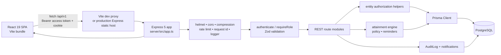
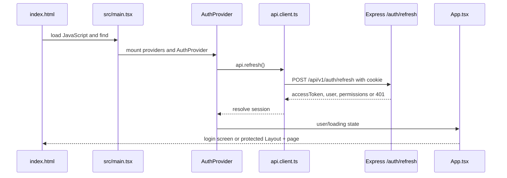
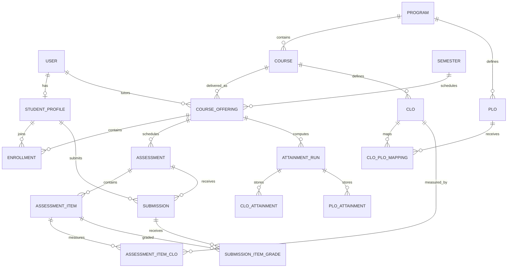

# System Architecture

## 1. Actual architecture



The current backend does not use a separate repository layer or controller directory. Route handlers are the application boundary;
`server/src/lib/authorization.ts` centralizes ownership checks, and `server/src/services/attainment*` contains the calculation
domain logic that must be deterministic and testable.

## 2. Browser startup



The refresh call is intentionally attempted on every provider mount. The access token lives in module memory in `src/api/client.ts`;
the refresh cookie is `httpOnly`, so browser JavaScript cannot read it.

## 3. Backend request lifecycle

```mermaid
flowchart TD
  Request[HTTP request] --> Pino[pinoHttp request id/logging]
  Pino --> Helmet[helmet]
  Helmet --> CORS[CORS]
  CORS --> Compression[compression + cookie parser + body parser]
  Compression --> Limit[global rate limit]
  Limit --> Health{health endpoint?}
  Health -->|yes| HealthResponse[JSON status ok]
  Health -->|no| Router[router module]
  Router --> Authenticate[router.use(authenticate)]
  Authenticate --> Validate[validate Zod params/query/body]
  Validate --> Role[requireRole/adminOnly when present]
  Role --> Ownership[getManagedOffering / assertCourseAuthor / viewer helpers]
  Ownership --> Handler[Prisma/service/audit/notify work]
  Handler --> Success[sendData or sendPaginated]
  Handler --> Error[asyncHandler forwards error]
  Error --> ErrorHandler[errorHandler maps AppError/Zod/Prisma]
```

`server/src/app.ts:32-98` installs cross-cutting middleware. Every domain router calls `router.use(authenticate)` or explicitly uses
`authenticate`, then handlers add role and resource checks. `server/src/lib/async-handler.ts` prevents rejected async promises from
becoming unhandled Express errors.

## 4. Main domain relationships



The concrete fields and all additional entities are documented in `05-DATABASE-ARCHITECTURE.md`.

## 5. Design decisions visible in code

1. **Database authority for current identity:** access-token claims are not trusted for current role or activation; `authenticate`
   reloads the user (`server/src/middleware/auth.ts:18-27`).
2. **Resource-level authorization:** role checks alone are insufficient. Tutors are restricted by `tutorId`, and course/CLO access
   uses offering ownership or student enrollment (`server/src/lib/authorization.ts`).
3. **Persisted attainment snapshots:** reports read stored `AttainmentRun`, `CloAttainment` and `PloAttainment` rows rather than
   recalculating raw marks during every report request.
4. **Soft retirement for evidence-bearing records:** assessments and CLOs are archived or rejected for deletion when evidence exists.
5. **Audit and notification side effects:** consequential changes call `audit()` and, where appropriate, `notify()` from route handlers.
