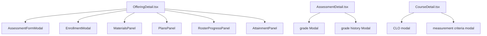

# Frontend Architecture

## 1. Composition root

`src/main.tsx:10-21` is the frontend composition root:

```tsx
createRoot(document.getElementById('root')!).render(
  <StrictMode>
    <BrowserRouter>
      <ToastProvider>
        <ConfirmProvider>
          <AuthProvider>
            <App />
          </AuthProvider>
        </ConfirmProvider>
      </ToastProvider>
    </BrowserRouter>
  </StrictMode>
);
```

The order creates four runtime facilities:

- `BrowserRouter`: URL-to-component routing.
- `ToastProvider`: transient operation feedback.
- `ConfirmProvider`: reusable confirmation dialogs.
- `AuthProvider`: session restoration and current user/permissions.

## 2. Route and shell hierarchy

```mermaid
flowchart TD
  Main[src/main.tsx] --> Router[BrowserRouter]
  Router --> App[src/App.tsx]
  App --> Login[/login → Login]
  App --> RequireAuth[RequireAuth]
  RequireAuth --> Layout[Layout.tsx]
  Layout --> Sidebar[role-filtered navigation]
  Layout --> Header[notifications + account menu]
  Layout --> Outlet[React Router Outlet]
  Outlet --> Dashboard
  Outlet --> Structure[departments / programs / semesters / courses]
  Outlet --> Teaching[offerings / offering detail / assessment detail]
  Outlet --> Outcomes[PLOs / CLO-PLO mapping / reports]
  Outlet --> Account[profile / settings / notifications]
  Outlet --> Admin[users / policies / audit]
```

`src/App.tsx:65-85` nests authenticated routes under `RequireAuth`. `RoleRoute` is a client-side usability guard, not the security
boundary: the corresponding Express endpoints enforce authorization again.

## 3. Page data lifecycle

Most pages use `useAsync` (`src/hooks/useAsync.ts:4-31`):

1. A page creates a loader such as `useAsync(() => api.course(id), [id])`.
2. The hook increments a request version and marks `loading=true`.
3. The API client sends the request.
4. Only the latest request version may update `data`, `error` or `loading`; this prevents an older response overwriting a newer one.
5. The page chooses `Loading`, `ErrorState`, empty state or actual content.
6. Mutations call an API method, show a toast, and call `reload()` or a parent callback.

This is an intentionally small server-state mechanism. There is no Redux store or React Query cache in the project.

## 4. API client design

`src/api/client.ts:74-110` centralizes `fetch` behavior:

- Builds `/api/v1` URLs and query strings.
- Adds the in-memory `Authorization: Bearer ...` header.
- Sends cookies with `credentials: 'include'`.
- On a 401, calls `/auth/refresh` once and retries the original request.
- Parses the standard `{ data, meta }` or `{ error }` envelope.
- Throws `ApiError(status, code, message, details)` so pages can show server messages.

The `api` object starting at `src/api/client.ts:116` is the typed frontend endpoint catalog. `src/api/types.ts` defines the objects
returned by those endpoints; these are TypeScript contracts, not runtime validation.

## 5. Shared UI

`src/components/ui.tsx` provides visual and interaction primitives. Examples:

- `Button` (`:21-52`) merges variants, size, loading and disabled behavior.
- `Card`, `CardHeader`, `PageHeader` (`:55-113`) standardize page layout.
- `Field`, `Input`, `Select`, `Textarea` (`:116-167`) connect labels and controls.
- `Modal` (`:171-257`) handles focus restoration, Escape, Tab trapping and body scroll locking.

Pages own domain state and compose these primitives. This keeps `CourseDetail.tsx` focused on CLO behavior instead of repeating CSS
and modal accessibility logic.

## 6. Tutor-facing component tree



`OfferingDetail.tsx:45-85` defines tab state from the URL (`?tab=`), loads the offering, attainment and plans, and renders panels
for the selected tab. `AssessmentFormModal` creates the complete assessment payload including items, rubric criteria and CLO
mappings; the server validates the same relationships again.

## 7. React concepts actually used

- **Props:** panel inputs such as `offeringId`, `clos`, `onChanged` and `onError`.
- **State:** form values, modal visibility, selected tabs and drafts through `useState`.
- **Effects:** initial loading and session restoration through `useEffect`.
- **Memoization:** derived values such as `studentSubmission` or PLO chart rows with `useMemo`.
- **Refs:** request-version and modal focus references with `useRef`.
- **Context:** cross-cutting auth, toast and confirmation state.
- **Composition:** pages build larger screens from small components rather than inheritance.
- **Keys:** database IDs identify rendered lists; local form rows use indexes where the row is still local draft state.
