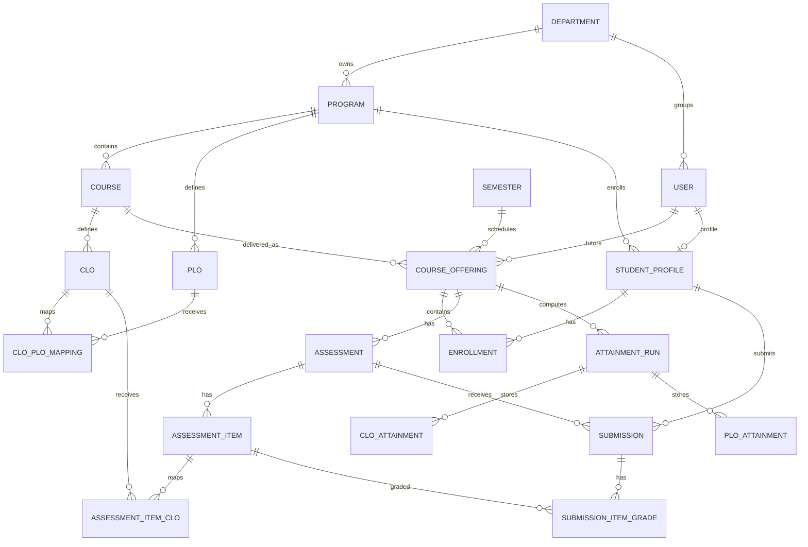

# Database Architecture

## 1. Schema source

`prisma/schema.prisma` uses PostgreSQL, UUID primary keys and Prisma relations. The schema currently defines 29 models, including
identity, academic structure, outcomes, assessments, grading, attainment, notifications, plans, audit, materials, measurement
criteria and grade history.

## 2. Model groups

### Identity and access

- `User`: email, bcrypt password hash, role, active/lock state and department.
- `RefreshToken`: hashed opaque refresh token, expiry, revocation, user agent and IP.
- `Department`.

### Academic structure

- `Program` belongs to `Department`.
- `Semester` contains date range and active flag.
- `Course` belongs to `Program`.
- `CourseOffering` joins a course, semester and tutor, and has a section/status/reporting period.
- `StudentProfile` belongs to a user and program.
- `Enrollment` joins students to offerings with status.

### Outcomes

- `Clo` belongs to a course and has approval, mastery threshold and archive state.
- `Plo` belongs to a program and has target attainment.
- `CloPloMapping` is the many-to-many join with weight.
- `CloMeasurementCriterion` belongs to a CLO and is versioned with `supersededAt`.

### Assessment evidence

- `Assessment` belongs to an offering and has status, due date, late policy and publication timestamps.
- `AssessmentItem` belongs to an assessment and has maximum marks.
- `AssessmentItemClo` maps an item to one or more CLOs with evidence weight.
- `RubricCriterion` belongs to an item.
- `Submission` joins an assessment to a student.
- `SubmissionItemGrade` stores item marks/state/feedback.
- `SubmissionCriterionGrade` stores rubric marks/feedback.
- `GradeChange` stores immutable mark-change history.

### Attainment and improvement

- `AttainmentPolicy` stores a named version and JSON configuration.
- `AttainmentRun` stores a calculation period, engine version, policy version and policy snapshot.
- `CloAttainment` stores persisted cohort results and evidence JSON.
- `PloAttainment` stores persisted weighted PLO results and evidence JSON.
- `ImprovementActionPlan` records a gap, follow-up, status, due date and evaluation.

### Operational evidence

- `Notification` stores recipient-specific messages and read/delivery state.
- `AuditLog` records actor, action, entity, request metadata and JSON metadata.
- `CourseMaterial` stores controlled HTTP(S) material links.

## 3. Relationship diagram



## 4. Integrity rules visible in the schema

- UUID IDs prevent sequential resource enumeration by default.
- Unique constraints prevent duplicate emails, program codes, course codes within a program, offering identity, CLO codes per course,
  PLO codes per program, item labels per assessment and one submission per assessment/student.
- `onDelete` behavior is deliberate: evidence-bearing relationships often restrict parent deletion, while dependent operational rows
  cascade where historical preservation is not the parent entity's responsibility.
- Prisma enums encode roles, statuses, approval state, assessment type, late policy, grade state and attainment status.
- Versioned migrations preserve the database history; `20261103110000_version_clo_measurement_criteria` preserves superseded criteria.

## 5. Query examples from the application

The application uses Prisma rather than hand-written SQL. Examples:

```ts
// Tutor-owned courses: server/src/routes/structure.ts:245-253
{ offerings: { some: { tutorId: user.id } } }

// Enrolled student's offerings: server/src/routes/offerings.ts:45-49
{ enrollments: { some: { studentId: profileId, status: { in: ['ENROLLED', 'COMPLETED'] } } } }

// Latest persisted run: server/src/routes/attainment.ts:140-159
prisma.attainmentRun.findFirst({
  where: { offeringId },
  orderBy: { computedAt: 'desc' },
  include: { cloResults: ..., ploResults: ... }
})
```

The learner should read these as relational filters: Prisma translates nested relation filters into SQL joins/EXISTS conditions and
parameterizes values, avoiding string-concatenated SQL injection.
