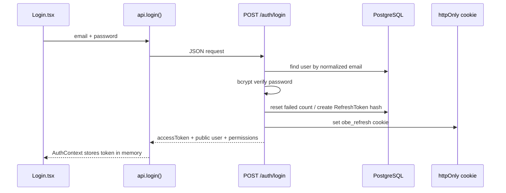

# Authentication and Authorization

## 1. Authentication versus authorization

Authentication answers: “Who is this request from?” Authorization answers: “May this authenticated identity perform this action on this
resource?” The project intentionally implements both:

- Authentication: JWT verification plus a database lookup in `server/src/middleware/auth.ts:7-32`.
- Authorization: role gates and ownership/enrollment queries in `server/src/middleware/auth.ts:34-42` and
  `server/src/lib/authorization.ts`.

## 2. Login lifecycle

`server/src/routes/auth.ts:85-157` validates email/password, locks after five failures for fifteen minutes, uses
`verifyPassword`, creates a refresh record and returns permissions derived from the role.

## 3. Token design

`server/src/lib/tokens.ts` implements two different token types:

- Access token: signed JWT, short TTL, issuer `obe-system`, audience `obe-client` (`:15-35`). The payload includes `sub`, role and
  email, but the middleware reloads current role/status from the database.
- Refresh token: 48 random bytes, returned only in an `httpOnly`, `sameSite=lax` cookie. Only its SHA-256 hash is persisted
  (`:38-48`). The cookie path is limited to `/api/v1/auth` (`:50-57`).

Refresh rotation at `auth.ts:160-203` revokes the used row and creates a new row in one transaction. Reuse of the old cookie fails.

## 4. Frontend session behavior

`AuthContext.tsx:21-39` calls `api.refresh()` on mount. `src/api/client.ts:91-95` also refreshes and retries a request once after a
401. `logout()` calls the server, then clears the in-memory token and React user state (`AuthContext.tsx:50-58`).

`App.tsx:28-45` redirects unauthenticated users to `/login`; `RoleRoute` hides routes from roles not listed. This improves user
experience, but it does not replace backend checks.

## 5. Resource authorization

Examples:

- `getManagedOffering`: admin or tutor whose ID equals `offering.tutorId`.
- `getOfferingForViewer`: admin, assigned tutor, or student with `ENROLLED`/`COMPLETED` enrollment.
- `assertCourseAuthor`: admin or tutor with an offering for the course.
- `assertAssessmentManager`: admin or assigned tutor.
- `getSubmissionForViewer`: admin, assigned tutor, or the student who owns the submission.

The design prevents IDOR: knowing a UUID is not enough. A tutor asking for another tutor's offering receives 403 even if the UUID is
valid. This is asserted by `server/tests/rbac.test.ts` and `tutor-panel.test.ts`.

## 6. Password and account controls

- Passwords are hashed with bcrypt in `server/src/lib/password.ts`.
- Login failures increment counters and can set `lockedUntil`.
- Deactivated or locked users fail `authenticate` even if an old access token is unexpired.
- Password change and admin reset revoke active refresh tokens.
- Profile self-service accepts only `name` and `phone` (`auth.ts:247-283`); role, status, email and assignments are not accepted.

## 7. Security learning exercise

Predict the result before reading the helper: a tutor sends `GET /api/v1/offerings/<another-tutor-id>` with a valid bearer token. The
request passes authentication and the `TUTOR` role, but `getOfferingForViewer` compares `offering.tutorId` to `req.user.id` and
returns 403. This demonstrates why role-based access alone is insufficient.
