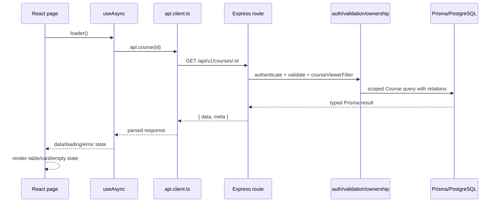
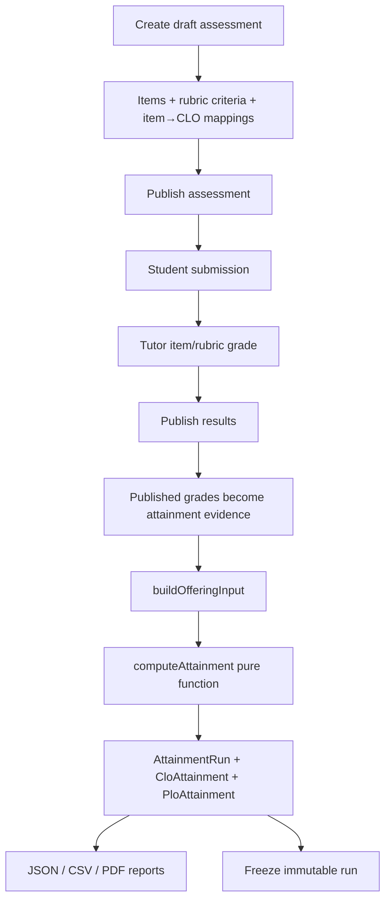
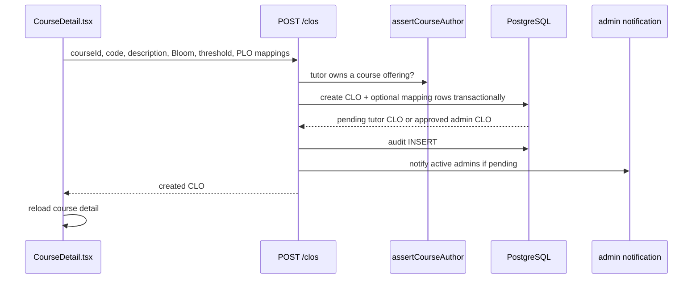

# End-to-End Data Flow

## 1. General read flow

## 2. General mutation flow

The mutation pattern is visible in `CourseDetail.tsx:80-115`:

1. Browser event calls `submit`.
2. `preventDefault()` stops a full page navigation.
3. Local validation checks obvious empty input.
4. `api.createClo` or `api.updateClo` serializes JSON.
5. Express validates UUID/body with Zod.
6. Handler checks ownership/role.
7. Prisma inserts/updates and may use a transaction.
8. Audit/notification side effects run.
9. API returns the row.
10. React closes the modal, shows a toast and reloads the query.

## 3. Assessment-to-attainment flow

The evidence gate is in `server/src/services/attainment-service.ts:61-75`: only `PUBLISHED`/`CLOSED` assessments with
`resultsPublishedAt` are included for normal staff computation. The engine output is persisted with policy and evidence snapshots.

## 4. CLO create flow

## 5. Report flow

`server/src/routes/reports.ts:25-80` builds the authorization-filtered latest run set. `buildReport` then creates CLO rows directly from
persisted `CloAttainment` rows and computes programme PLO roll-up from persisted CLO results. CSV and PDF call the same `loadRuns` and
`buildReport`, so export scope matches the visible report rather than bypassing authorization.
