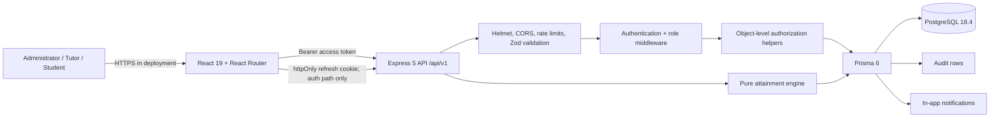
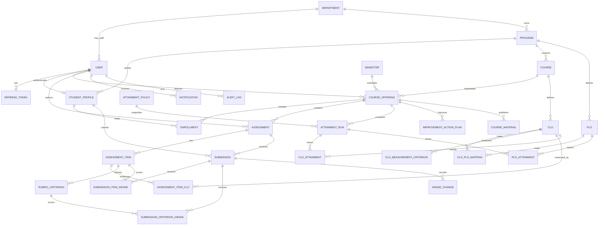
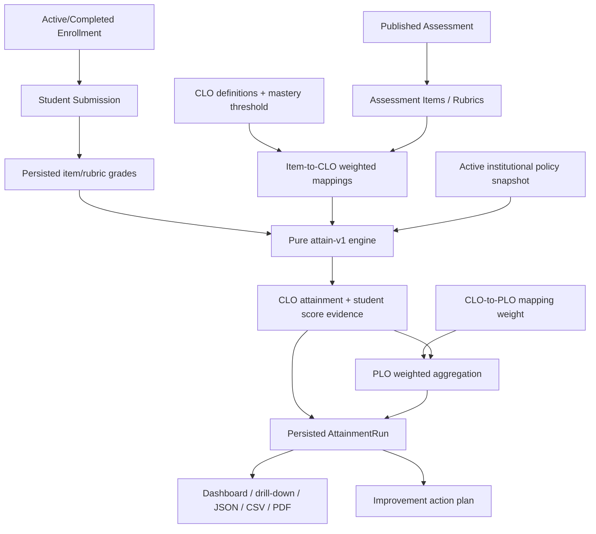

# OBE Management System — Complete System Audit Report

> **Audit date:** 2026-11-05
> **System:** OBE Management System 1.0.0
> **Scope:** authentication, identities, PostgreSQL relationships, Administrator/Tutor/Student panels, cross-role academic workflows, authorization, security, UI reliability, automated regression and repository readiness
> **Execution environment:** portable Node.js 22.23.4; embedded PostgreSQL 18.4 on port 5433; real headed Google Chrome through Playwright
> **Evidence rule:** results under “Newly executed” were run during this audit. Older figures are retained only as historical context.

---

## 1. Executive Summary

The existing React + Express + Prisma + PostgreSQL application was audited in place; it was not rebuilt and its authentication architecture was not replaced. The three roles resolve through one `User` identity model, with a one-to-one `StudentProfile` only for students. Tutors and administrators are represented by the `User` row plus role and department fields; there are no duplicate staff-authentication tables.

The system-wide runtime result is **functionally verified with one application defect found and fixed**:

- The administrator enrollment endpoint filtered on `StudentProfile.isActive` but did not also require the related authentication `User.isActive`. It could therefore enroll a student whose login account had been deactivated. The query now requires both active states, and a regression test proves rejection.
- Authentication, DB-authoritative roles, refresh rotation, account lockout, role/ownership isolation, academic calculations, dashboards, notifications and report scoping behaved as designed in executed tests.
- The read-only development-database scan found zero orphan, duplicate, cross-course, over-mark or session-state integrity violations after the standard seed was installed.
- The fresh complete regression passed: **20/20 unit, 83/83 integration/API and 28/28 headed Chrome tests**, with clean TypeScript and ESLint and a successful production build.

This is strong evidence for the audited feature set, but not an unconditional production-readiness claim. Deployment hardening, non-Chromium browser coverage, automated CI, external notification delivery, load testing and operational backup/restore validation remain outside this local audit.

---

## 2. System Architecture

### 2.1 Runtime architecture



| Layer | Actual implementation | Responsibility |
|---|---|---|
| Browser | React 19.2, React Router 7.18, Vite 8.2, Tailwind/Vite, Recharts | Role-aware pages, forms, navigation, feedback and report display. Frontend guards improve UX but are not the security boundary. |
| API | Express 5.1, Zod 4, JWT, bcryptjs | Authentication, validation, RBAC, ownership enforcement, business invariants, audit and notifications. |
| Data | Prisma 6.19 + PostgreSQL | Authoritative users, profiles, structure, enrollment, outcomes, assessments, grades, calculations and history. |
| Calculation | Pure TypeScript attainment engine (`attain-v1`) | Deterministic CLO/PLO computation from persisted evidence and policy snapshots. |
| Verification | Vitest, Supertest, Playwright | Pure calculation tests, real Express/PostgreSQL tests and headed browser workflows. |

### 2.2 Persistence and environment safety

- Development uses database `obe`; integration and browser suites use disposable `obe_test` and `obe_e2e` databases.
- The embedded PostgreSQL launcher probes filesystem permission behavior and falls back from the NTFS/FUSE workspace to `~/.local/share/obe-pg/`. That safeguard remains intact.
- Nine migrations were inspected. Searches for destructive migration statements confirmed there are no `DROP TABLE`, `DROP SCHEMA`, `DROP DATABASE`, `TRUNCATE` or `DELETE FROM` operations. Matches for the word `DELETE` are foreign-key `ON DELETE` actions or enum text.
- The development database existed but had never been provisioned because earlier PostgreSQL startup failed on the NTFS mount. `prisma migrate deploy` created the absent schema and the existing seed installed the documented demonstration data. No existing academic row was deleted or overwritten.

---

## 3. Authentication Architecture

### 3.1 Browser-to-database flow

```mermaid
sequenceDiagram
    actor User
    participant UI as React UI
    participant API as Express /auth
    participant DB as PostgreSQL

    User->>UI: Submit official email + password
    UI->>API: POST /api/v1/auth/login
    API->>API: Login rate limit + Zod normalization
    API->>DB: Load User by normalized email
    DB-->>API: hash, role, active flag, lock state
    API->>API: bcrypt verify; update failure/lock counters
    alt invalid credentials
        API->>DB: Audit LOGIN_FAILED
        API-->>UI: 401 generic credential error
    else deactivated or locked
        API-->>UI: 403 deactivated / 423 locked
    else valid
        API->>DB: Reset failures, set lastLoginAt, store SHA-256 refresh hash
        API->>DB: Audit LOGIN
        API-->>UI: JWT access token + path-scoped httpOnly refresh cookie
    end

    UI->>API: Protected call with Bearer access token
    API->>API: Verify signature, expiry, issuer and audience
    API->>DB: Re-read User by JWT subject
    DB-->>API: Current role, isActive and lockedUntil
    API->>API: Apply route role + object ownership policy
    API-->>UI: Role-scoped response / 401 / 403

    UI->>API: POST /api/v1/auth/refresh with cookie
    API->>DB: Find SHA-256 token hash and active user
    API->>DB: Transaction: revoke old token + store next hash
    API-->>UI: New access token + rotated refresh cookie

    UI->>API: POST /api/v1/auth/logout
    API->>DB: Revoke current refresh row
    API-->>UI: Clear refresh cookie
```

### 3.2 Implemented controls

| Control | Finding |
|---|---|
| Provisioning | There is no open registration endpoint. Administrators provision accounts through guarded user APIs. |
| Password storage | Passwords are hashed with `bcryptjs`; hashes are never included in public-user responses. |
| Access token | Signed JWT with required issuer `obe-system`, audience `obe-client`, subject, email and role; expiry is environment-configured. |
| Server authority | `authenticate` verifies the token, then re-reads current role, `isActive` and `lockedUntil` from PostgreSQL for every protected request. Client-supplied/stale role claims do not control authorization. |
| Refresh token | Cryptographically random 48-byte opaque value; only SHA-256 hash is stored. Cookie is `httpOnly`, `SameSite=Lax`, environment-controlled `Secure`, and restricted to `/api/v1/auth`. |
| Rotation/reuse | Successful refresh transactionally revokes the used row and creates a new one. Reusing the old cookie is rejected. There is no token-family compromise cascade beyond rejection of the reused token. |
| Logout | Revokes the matching unrevoked token and clears the cookie. |
| Lockout | Five failed passwords trigger a 15-minute lock; a subsequent login receives `423 LOCKED`. Successful login after expiry clears counters. |
| Rate limiting | Login: 10 attempts per 15 minutes with successful requests skipped; application-level limiting is also configured. Login limiting is intentionally skipped in `NODE_ENV=test`. |
| Password change | Requires current password, validates the replacement, updates hash and revokes every active refresh token in one transaction. |
| Admin reset | Administrator-only; changes the hash, clears lockout state, revokes refresh sessions and writes audit metadata. |
| Account changes | Deactivation immediately invalidates even a still-valid signed access token because middleware consults PostgreSQL. |
| Profile endpoint | `/auth/me` returns the DB identity; self-service updates allow only name/phone, not role, status or assignments. |
| Audit | `LOGIN`, `LOGIN_FAILED`, password and administrative reset events are persisted. Unknown-email failure messages match known-email failure messages. |

### 3.3 Executed authentication evidence

- Valid login and `/auth/me` identity resolution passed.
- Invalid and unknown credentials both returned the same generic 401 message.
- Missing, malformed, tampered and expired access tokens returned 401.
- A live access token stopped working immediately after account deactivation or lockout.
- Direct database role changes took effect despite stale token role claims.
- Refresh rotation passed; reuse, unknown refresh values and expired refresh rows were rejected.
- Sessions survived a full browser reload through the refresh flow.
- Logout removed the session and protected routes redirected to login.
- Current-password validation, user password rotation and admin reset/session revocation passed.

---

## 4. User Identity and Database Relationships

### 4.1 Identity model

- `User` is the sole authentication identity for all roles.
- `Role` is a PostgreSQL/Prisma enum: `ADMIN`, `TUTOR`, `STUDENT`.
- Students require exactly one `StudentProfile`; `StudentProfile.userId @unique` prevents duplicate profiles and `rollNo @unique` prevents duplicate roll numbers.
- Tutors and administrators do not have separate profile tables. Their staff identity is the `User` row with role, optional unique employee number and department relationship.
- `Enrollment @@unique([studentId, offeringId])` prevents duplicate student/offering relationships.
- User deactivation is soft and preserves all academic foreign-key history.

### 4.2 Actual ER diagram (core and evidence models)



The schema contains 25 models and 17 enums. Core delete behavior is intentional: restrictive relationships protect institution/course structures, user-owned session/profile rows use appropriate cascade behavior, and nullable historical actors/items use `SetNull` where preservation is required.

### 4.3 Identity findings by role

| Role | Relationship result |
|---|---|
| Administrator | Role resolves from `User`; no accidental student/tutor profile requirement; all administrative mutations are backend guarded. |
| Tutor | `User.departmentId` supplies department relationship; `CourseOffering.tutorId` supplies assignment/ownership; offering and report queries constrain results to that tutor. Reassignment updates the owner but does not delete offering evidence. |
| Student | `StudentProfile.userId` is one-to-one; programme, roll number and enrollment relationships are FK/unique protected; student queries derive visibility from own profile/enrollments, never a client-provided student ID. |

Attendance is not represented in the actual schema and is therefore **not implemented**, rather than being simulated or reported as verified.

---

## 5. Role-Based Access Matrix

Legend: **Own** = object-level scope; **Read** = permitted read; **Manage** = create/update or workflow action; **—** = unavailable.

| Surface | Administrator | Tutor | Student | Backend enforcement |
|---|---|---|---|---|
| Dashboard | Institutional | Assigned-course | Personal academic | Authenticated role branch + scoped Prisma queries |
| Departments/programmes/sessions | Manage | Scoped programme reads | Own programme context | `adminOnly` writes; role filters |
| Users/accounts | Manage | — | — | `adminOnly` |
| Student roster | Institution/filter | Own offerings | — | ADMIN/TUTOR + tutor enrollment scope |
| Courses | Manage | Assigned/author scope | Via enrolled offering | Role and course-author helpers |
| Offerings | Manage/reassign/archive | Own | Enrolled only | `adminOnly` mutations; `getOfferingForViewer` / `getManagedOffering` |
| Enrollment | Manage | Read own roster | Own enrollment visibility | Admin-only mutations; scoped reads |
| CLOs | Author/approve/archive | Author own course; approval restrictions | Approved outcomes only | Course ownership + role checks |
| PLOs/mappings | Manage | Own taught-program context | Drill-down for enrolled evidence | Programme/course scope and frozen-run guards |
| Assessments/items/rubrics | Manage | Own offering | Published/closed enrolled only | Assessment-manager and viewer helpers |
| Submission | Staff visibility | Own offering grading | Own only | `getSubmissionForViewer`; assessment/enrollment checks |
| Grades/history | Manage | Own offering | Own published results only | Ownership + publication gates |
| Attainment runs | Institution | Compute/freeze own | Sanitized enrolled results | Offering ownership + student sanitization |
| Reports/CSV/PDF | Institution | Own evidence | Own/enrolled evidence | Shared role-aware report query |
| Improvement plans | Institution view | Manage own course gaps | — | Role + offering ownership |
| Notifications | Own + admin broadcast | Own | Own | Recipient predicates; admin-only broadcast |
| Audit log | Read/filter | — | — | `adminOnly` |
| Profile/settings | Own safe fields/password | Own | Own | Auth identity; fixed update schema |

Frontend `RoleRoute` and filtered navigation hide inappropriate modules, but direct URL and API tests verify that the backend remains the actual security boundary. Unauthorized API access returns 401 for invalid authentication and 403 for authenticated role/ownership violations; recipient-scoped resources may deliberately return 404 to avoid exposing another user’s record.

---

## 6. Administrator Panel Report

| Module | Verification result |
|---|---|
| Dashboard | Counts are live database aggregates; API/direct DB and UI/API comparisons passed. |
| Departments | Create, search, update, deactivate, validation, duplicates, audit and role denial passed. |
| Programmes | Department FK validation, create, duplicates, search and role-scoped reads passed. |
| Academic sessions | Date validation, exactly-one-active transactional behavior, used-row delete conflict and notifications passed. |
| Courses/offerings | Creation, tutor validation, assignment/reassignment, status/archive, persistence and scoped reads passed. |
| Users/students | Staff/student profile rules, unique email/employee number, pagination/search, soft deactivate/reactivate and self-deactivation guard passed. |
| Enrollment | Admin-only enroll/status mutations, persistence, audit, notification and inactive-identity rejection passed. |
| CLO/PLO/mapping | Outcome authoring, approval, same-programme mapping and frozen evidence protections passed. |
| Policies/attainment | Single-active policy, computation, persisted policy snapshot and frozen-run behavior passed. |
| Reports/audit | Institutional report reads, CSV/PDF access, audit filters and admin-only audit access passed. |
| Notifications/profile | Recipient scope, admin broadcast behavior, role-aware title and safe account settings passed. |

Loading, empty, validation, success and error states are implemented in the audited React pages. Headed Chrome workflows cover the most consequential write paths; API integration coverage supplies deeper negative validation and direct database assertions than a UI-only audit could.

---

## 7. Tutor Panel Report

The Tutor Panel remains complete and unaffected by the enrollment fix. Executed evidence verifies:

- Assigned-only dashboard, course list and offering detail.
- Cross-tutor object-ID rejection through API and browser URL manipulation.
- Student roster restricted to the tutor’s offering, including publication-aware progress.
- CLO creation/editing, versioned measurement criteria, admin approval and archive/restore evidence guard.
- Assessment creation, questions/items, rubric criteria, CLO mapping, publish/close/archive behavior and late policies.
- Submission review, item/rubric grading, result publication, regrade reason and persistent `GradeChange` history.
- CLO calculation, PLO drill-down, frozen evidence, improvement plans and report/CSV/PDF authorization.
- In-app notifications, profile self-service and password rotation.

The complete headed workflow performs login → course → CLO/criteria → approval → assessment/rubric/mapping → publication → student submission → grading/results → regrade/history → attainment → PDF/PLO evidence → archive/restore → cross-tutor denial.

---

## 8. Student Panel Report

Executed API and browser evidence verifies:

- Dashboard and offering lists originate from `Enrollment` rows with allowed statuses.
- A student cannot open an unrelated offering, another student’s submission or another recipient’s notification.
- Offering detail exposes only the student’s enrollment and published/closed assessments; manager rosters are not leaked.
- The student can submit once to an eligible published assessment, subject to due date/late policy.
- Results, feedback and progress are visible only for the authenticated student and only after publication gates permit them.
- CLO/PLO progress uses persisted evidence for the enrolled offering; missing individual evidence is represented as `INSUFFICIENT_DATA`, not fabricated.
- Deactivation immediately blocks a signed access token while preserving profile, enrollment, submission and grade history.
- Student profile and settings resolve the correct database identity and programme.

Attendance and a standalone transcript/grade-history page are not separate implemented modules. Grade corrections are nevertheless preserved in the backend `GradeChange` model and staff workflow.

---

## 9. Cross-Role Workflow Report

| Workflow | Executed evidence | Result |
|---|---|---|
| A — Admin to Tutor | Admin creates/selects structure and offering, assigns tutor, configures CLO/PLO mapping; tutor sees only assignment and course outcomes; DB relations asserted in workflow/admin suites. | **Passed** |
| B — Admin to Student | Admin account/profile rules, programme link, admin-only enrollment, persistence/audit/notification, student offering visibility and unrelated offering denial. New inactive-auth-account regression included. | **Passed** |
| C — Tutor to Student | Tutor-owned roster, assessment/items/rubric/CLO mapping, submission, grading/publication, student’s own result/feedback and persisted marks. | **Passed** |
| D — Institutional reporting | Attainment computation, persisted run, admin/tutor report views, PLO roll-up, JSON/CSV/PDF exports and formula neutralization. | **Passed** |
| E — Lifecycle | Soft user deactivation/reactivation, live-token invalidation, tutor reassignment notifications, enrollment status changes, offering archival, single-active session/policy, password reset, logout and reauthentication. | **Passed for implemented lifecycle operations** |

History-preservation checks confirmed that account deactivation does not delete academic evidence, enrollment status changes update rather than remove rows, regrades append history, outcomes use soft archival/evidence guards, and frozen attainment data is immutable.

---

## 10. OBE Data Flow and Calculation Report



### Calculation rules implemented

1. For each student/CLO, graded item percentages are weighted by that item’s CLO mapping weight.
2. `EXCUSED` evidence is excluded. Missing/`INCOMPLETE` evidence follows the versioned policy (`exclude` or `zero`).
3. A student masters the CLO when the weighted score reaches the CLO’s mastery threshold.
4. Cohort CLO attainment is `attained eligible students / eligible students × 100`.
5. Cohorts below `minCohortSize` return `INSUFFICIENT_DATA`.
6. Status is `MET` at target, `AT_RISK` within the configured band, otherwise `NOT_MET`.
7. PLO attainment is a weighted mean of contributing eligible CLO attainment. Default weighting combines CLO–PLO mapping strength and eligible cohort size.
8. Results are rounded per policy and persisted with policy/engine version, evidence metadata, reporting period and calculation timestamp.

The engine rejects malformed evidence (unknown/duplicate item grade, non-finite/negative marks, marks above maximum and non-positive weights) instead of returning plausible but invalid percentages. Unit tests cover deterministic calculation behavior; integration/browser tests prove persistence and presentation.

---

## 11. Error and Defect Register

### 11.1 Application defects

| ID | Severity | Root cause | Affected flow | Resolution | Regression evidence |
|---|---|---|---|---|---|
| SYS-001 | High | `POST /offerings/:id/enrollments` required `StudentProfile.isActive` but not related `User.isActive`. A deactivated login identity could still be selected by direct API request. | Admin → Student enrollment; identity consistency; notifications | Added `user: { isActive: true }` to the Prisma selection predicate. Invalid/inactive sets fail atomically with a validation error. | `server/tests/auth-lifecycle.test.ts`: inactive user rejected; admin succeeds; Tutor/Student receive 403; DB/audit/notification asserted. |
| UI-001 | Low (historical) | Profile heading was hardcoded to Tutor. | Admin/Student profile trust | Role-aware Administrator/Tutor/Student title retained and reverified. | Existing browser/static regression. |

No critical authentication bypass, cross-user grade leak, calculation corruption or destructive schema defect was found.

### 11.2 Audit/test defects corrected

- The new read-only scanner originally treated repeated `NULL employeeNo` values as duplicates. SQL now excludes `NULL`, matching PostgreSQL uniqueness semantics.
- Its first item↔CLO course-consistency query had an incorrect subquery/OR expression and produced false positives. It now directly joins the assessment offering and compares `CourseOffering.courseId <> Clo.courseId`.
- Initial role-view console collection counted the login page’s expected anonymous refresh/me 401 probes as workspace console failures. Collection now starts after successful login; all authenticated role routes are clean. The 401s remain correctly handled authentication behavior, not suppressed application errors.

---

## 12. Security Audit

| Area | Finding |
|---|---|
| Authentication bypass | Missing/invalid/tampered/expired tokens rejected; protected routes require middleware. |
| Role escalation | Backend ignores stale token role for decisions and uses current DB role; admin APIs deny Tutor/Student. |
| IDOR | Cross-tutor offering and cross-student offering/submission/notification requests are denied or non-enumerating 404. |
| Deactivation | Current access token fails immediately; refresh also checks active user. |
| Session security | Opaque hashed refresh token, rotation, revoke-on-use, path-scoped httpOnly cookie, logout/password revocation. |
| Credential attacks | Generic invalid-login response, rate limit, five-attempt lockout and audit trail. |
| SQL injection | Production route/service data access uses parameterized Prisma APIs. The only raw SQL added is a standalone read-only local audit script, not mounted in the application. |
| XSS | React output escaping and schema validation are present; no unsafe HTML rendering was found in audited pages. |
| CORS/headers | Explicit client origin through CORS; Helmet enabled. |
| Sensitive data | Password hashes and refresh values are not returned; only refresh hashes persist. Student data is role/owner scoped. |
| CSV injection | Cells beginning with `=`, `+`, `-`, `@`, tab or carriage return are prefixed before CSV quoting. |
| Report export | JSON, CSV and PDF reuse role-aware filtered report data; export is audited. |
| Audit integrity | Consequential changes are recorded. Rows are application-append-only, but cryptographic hash chaining is not implemented. |

Refresh reuse is rejected, but the implementation does not model token families or automatically revoke all descendant sessions when an already-revoked token is replayed. That is a defense-in-depth opportunity, not evidence of a current bypass.

---

## 13. User Experience and UI Audit

- Role-filtered sidebar/module navigation corresponds to actual React routes and backend permissions.
- Direct unauthorized URLs redirect to the dashboard in the frontend and still fail at the API boundary.
- Account/profile headings are role-aware.
- Forms expose validation messages and success/error feedback; destructive/important state transitions use confirmation where implemented.
- Pages provide loading and empty-state components rather than fabricating fallback data.
- Dashboard and report values are database-backed and persist after reload.
- A 1440×900 headed Chrome sweep visited every permitted top-level route for all three roles and one accessible offering detail per role with no authenticated console errors or uncaught page errors.
- Existing layouts use responsive utility classes; the audit verified primary desktop rendering. A dedicated mobile-device matrix and accessibility conformance audit were not executed.

---

## 14. Test Execution Report

### 14.1 Historical baseline (not counted as newly executed)

| Layer | Historical reported result |
|---|---:|
| Attainment unit | 20/20 |
| Existing integration/API | 60/60 |
| Admin integration/API | 11/11 |
| Headed Chrome E2E | 25/25 |
| TypeScript / ESLint | Clean |

### 14.2 Newly executed on 2026-11-05

| Command/layer | Executed | Passed | Failed | Skipped | Result |
|---|---:|---:|---:|---:|---|
| `npm run test:unit` | 20 | 20 | 0 | 0 | 1 file; pure attainment engine |
| `npm test` | 83 | 83 | 0 | 0 | 7 files; real Express + disposable PostgreSQL |
| `npx playwright test` | 28 | 28 | 0 | 0 | 7 specs; real headed Google Chrome; 5.8 min |
| `npm run typecheck` | 2 projects | 2 | 0 | 0 | Web and server clean |
| `npm run lint` | 1 run | 1 | 0 | 0 | `oxlint --deny-warnings` clean |
| `npm run build` | 2 targets | 2 | 0 | 0 | Server + web build successful |
| Read-only development DB scan | 20 integrity probes + shape | all clean | 0 | 0 | No writes |

The 83 integration tests consist of the previous 71 plus 12 new authentication/lifecycle/enrollment tests. The 28 browser tests consist of the previous 25 plus 3 role-wide console/runtime sweeps. Playwright was configured and run headed with installed Chrome (`channel: chrome`, `headless: false` by default, `slowMo: 150`). A separate headless run was not counted because headless is only an environment override (`PW_HEADLESS=1`), not the requested/configured default for this workstation.

### 14.3 Coverage classification

The suites overlap by design; one test can prove API, database and security behavior. The following audited areas have executed automated evidence:

- API/integration: 83/83 (including auth, constraints, admin, tutor, workflow and enrollment).
- Admin E2E: 6 dedicated specs plus shared critical/workspace/console coverage.
- Tutor E2E: dedicated critical and complete workflows plus shared coverage.
- Student E2E: login/enrolled course/results/authorization plus shared coverage.
- Cross-role: admin assignment/provisioning, tutor-student evidence flow and complete role navigation.
- Security: auth lifecycle, refresh, RBAC, IDOR, CSV formula neutralization and unauthorized exports/routes.

---

## 15. Database Integrity Report

`server/scripts/db-audit.ts` performs query-only probes and exits without modifying records. Final development DB result:

| Probe family | Final result |
|---|---|
| Missing/orphan student identities | 0 / none |
| Duplicate profile, roll number, email or non-null employee number | none |
| Invalid role values | none |
| Duplicate enrollment pairs | none |
| Cross-program warning enrollment | none |
| Offering assigned to deactivated tutor | 0 |
| Tutor enrolled through own student identity | none |
| CLO approval metadata mismatch | none |
| Cross-program CLO–PLO mapping | none |
| Cross-course assessment-item↔CLO mapping | none |
| Grade above item maximum | none |
| Orphan refresh token | none |
| Inactive user with unrevoked refresh token | 0 |
| Unrevoked expired refresh token | 0 |
| Failure counter ≥5 without lock | 0 |

Seeded development shape after safe provisioning:

| Record | Count |
|---|---:|
| Active administrators / tutors / students | 1 / 3 / 14 |
| Student profiles | 14 |
| Enrollments | 18 |
| Offerings / courses | 5 / 4 |
| CLOs / PLOs / mappings | 9 / 8 / 11 |
| Assessments / submissions | 4 / 14 |
| Audit rows / notifications | 4 / 18 |

No automated repair was performed because no violating record remained. Disposable test database reset/reseed behavior is intentionally isolated from development data.

---

## 16. Performance and Reliability

- Database list APIs use shared pagination and role predicates; common relationship/filter columns have schema indexes and unique constraints.
- Multi-record invariants use transactions where atomicity matters: refresh rotation, password/session revocation, policy/session activation, enrollment batch upsert and criteria replacement.
- The attainment engine is deterministic and pure; persisted snapshots preserve policy and evidence context.
- Test execution is serialized where shared database/browser state requires it (`workers: 1` for Playwright), reducing flakiness.
- The production build succeeds, but Vite reports one JavaScript chunk around 1,250 kB (about 320 kB gzip), above its 500 kB advisory threshold. Route-level code splitting is recommended.
- This audit did not perform concurrency stress, latency/load testing, PostgreSQL failover, backup restoration, email delivery, or production observability validation.

---

## 17. Changes Implemented

### Product fix

- `server/src/routes/offerings.ts` — admin enrollment now requires both an active student profile and active authentication user.

### Verification additions

- `server/tests/auth-lifecycle.test.ts` — 12 tests for expired/tampered access tokens, deactivation, lock state, DB role authority, login lockout/recovery, expired/unknown refresh tokens, admin-only enrollment/status lifecycle, audit/notifications and preserved history.
- `e2e/system-role-views.spec.ts` — headed Chrome runtime/console sweeps across every permitted top-level route for Admin, Tutor and Student.
- `server/scripts/db-audit.ts` — reusable, read-only integrity scanner for identities, relationships, evidence and sessions.

### Earlier uncommitted work included in the audited working tree

- Admin integration/browser parity suites and reports.
- Authentication/workspace E2E coverage.
- Role-aware profile title.
- Headed real-Chrome Playwright reporting/artifact configuration.
- Embedded PostgreSQL NTFS permission detection/fallback and related test-environment reliability work.

No migration or schema change was required for this system audit.

---

## 18. Remaining Issues

| Priority | Limitation | Impact / next action |
|---|---|---|
| Medium | No CI pipeline in the repository | Provision Node 22 + PostgreSQL and run all commands on every pull request. |
| Medium | Browser automation is Chrome/Chromium only | Add Firefox/WebKit projects after confirming component compatibility. |
| Medium | Main web chunk exceeds Vite advisory threshold | Convert major route pages to lazy imports/code splitting and measure. |
| Medium | No load/concurrency or backup/restore exercise | Establish performance SLOs and disaster-recovery tests before production certification. |
| Low | Notifications are in-app only | Add external delivery workers and retry/dead-letter behavior if required. |
| Low | Refresh replay does not trigger token-family-wide revocation | Consider refresh-token family IDs and reuse-compromise response. |
| Low | Audit rows are not cryptographically chained | Add tamper-evident hash chaining/verification only if mandated. |
| Low | Anonymous session restore produces handled 401 resource entries in Chrome DevTools | Expected behavior; optionally add a cookie/session hint if a noise-free anonymous console is a product requirement. |
| Scope | Attendance is not modeled | Implement only after an explicit institutional workflow/schema design. |

No known critical or high-severity defect remains after SYS-001 was fixed and the complete regression rerun.

---

## 19. Final System Assessment

**Assessment: functionally complete and verified for the implemented local application scope; operational production certification remains pending.**

Verified facts:

- Authentication resolves the correct PostgreSQL user and does not trust client role claims.
- Account status/lock changes affect live access immediately.
- Student profiles, tutor assignments, enrollment, outcome mappings, assessment evidence and report relationships are constraint-backed and currently clean.
- Admin, Tutor and Student views are database-backed and role/owner scoped.
- Admin→Tutor, Admin→Student and Tutor→Student workflows persist and reconcile across both sides.
- CLO/PLO calculations are deterministic, policy-versioned and derived from persisted marks/mappings.
- Reports use the same scoped persisted results; CSV/PDF authorization and CSV formula handling are implemented.
- All newly executed tests and static/build gates pass with zero skips.

Not verified by this audit:

- Real production hosting/TLS/reverse-proxy configuration.
- Production secrets, email delivery, long-running operational behavior or backup restoration.
- Non-Chromium UI behavior, full mobile-device coverage, formal WCAG audit or penetration test by an independent team.
- Performance under institutional-scale concurrent usage.

---

## 20. Recommended Next Development Phase

1. **Add CI as the immediate next step:** Node 22, isolated PostgreSQL, migrations, 20 unit + 83 integration + 28 browser checks, typecheck, lint and build.
2. **Split the frontend bundle by route** and record before/after loading metrics.
3. **Add operational readiness tests:** backup/restore, migration rehearsal, concurrency/load, health/metrics/log aggregation and production secret rotation procedure.
4. **Expand browser/accessibility coverage:** Firefox, WebKit, representative mobile widths, keyboard navigation and WCAG checks.
5. **Strengthen optional security controls:** refresh-token families/reuse response and tamper-evident audit verification if policy requires them.
6. **Add external notification delivery** only with persistent delivery/retry semantics; do not replace the authoritative in-app records.
7. Preserve the existing evidence model and use additive migrations for any future attendance or accreditation features.

---

## Reproduction Commands

```bash
export PATH="$HOME/.local/opt/node-v22.23.4-linux-x64/bin:$PATH"
npm run test:unit
npm test
npx playwright test
npm run typecheck
npm run lint
npm run build
npx tsx server/scripts/db-audit.ts  # read-only; uses configured development DATABASE_URL
```

The browser command defaults to headed installed Google Chrome. Integration and browser global setups manage only disposable `obe_test` and `obe_e2e`; they do not reset the development `obe` database.
