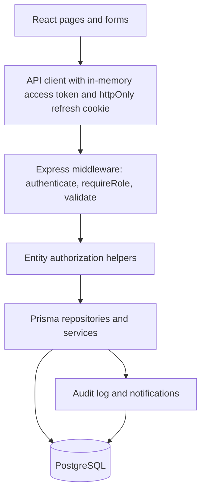

# Tutor Panel Architecture

The tutor panel is not a separate application. It is the same React + Express + PostgreSQL OBE system, presented through
server-enforced role boundaries and a tutor-centric workspace. This keeps administrative controls, academic workflows and
audit evidence on a single source of truth.

## Boundary model

| Layer | Responsibility |
|---|---|
| React front end | Present the tutor-facing sections: dashboard, courses, offerings, CLOs, PLOs, CLO–PLO mapping, assessments, submissions/grading, attainment, improvement plans, reports/exports, notifications, profile and settings. It renders authorization state but never substitutes it. |
| Express API | Authenticates Bearer access tokens, re-reads the user’s role and active status from the database on every request, and applies route-level role checks plus entity-level ownership checks. |
| PostgreSQL | Authority for users, courses, offerings, outcomes, assessments, submissions, grades, attainment runs and audit entries. |

The final gap-closure work keeps the same boundary model and adds:

- CLO measurement criteria as versioned PostgreSQL rows. Replacing criteria supersedes prior rows rather than deleting the wording
  used by an approved CLO; the active API view returns only the current version and `includeHistory=true` exposes preserved history.
- PLO drill-down filtering at both the programme and offering/CLO levels. Tutors see only runs and mapped CLOs from offerings they
  own; students see only their enrolled offerings.
- Roster progress derived from the current offering's persisted submissions and result-publication state. Cross-offering student
  submissions are excluded, and individual CLO scores are shown only when the attainment run persisted an evidence snapshot.
- A server-generated PDF report endpoint using the same filtered persisted runs as the JSON and CSV report endpoints.

## Authorization

- `authenticate` rejects missing or expired Bearer tokens, then loads the user from PostgreSQL. Role and `isActive` come
  from the database, so an edited account or revoked role takes effect immediately.
- `requireRole` and `adminOnly` gate whole routes; `getManagedOffering`, `getSubmissionForViewer`, `assertAssessmentManager`
  and `assertCourseAuthor` gate individual entities.
- Tutors only reach resources whose `tutorId` matches the authenticated user. Cross-tutor requests return 403, including for
  the resource ID itself, which prevents IDOR through guessing or leaked UUIDs.
- CLO–PLO mapping is open to tutors for outcomes in courses they actually teach. Administrators retain program-wide
  authority. A mapping that already contributed to a frozen attainment run is immutable, protecting accreditation evidence.

## Data flow

## Phase 2 areas

- **Tutor profile and settings**: self-service name/phone update on `PATCH /auth/me`; password change revokes every refresh
  token.
- **CLO management**: archive/unarchive with evidence guard; active lists exclude archived rows by default.
- **CLO–PLO mapping**: matrix UI with coverage gaps, same-programme enforcement and frozen-run protection.
- **Assessments**: expanded types, passing marks, submission format, late policy, archive/restore, and guarded editing.
- **Submissions and grading**: late policies `ACCEPT`, `REJECT`, `MARK_LATE`; grade changes are persisted as an immutable
  `GradeChange` trail and require a stated reason when correcting published results.
- **Reports**: CSV export re-uses the same authorization and filters as the JSON report and neutralizes spreadsheet formula
  prefixes.
- **Improvement plans**: record the observed gap, the follow-up method and status transitions with evaluation.
- **Measurement criteria**: author, view, validate and version observable CLO criteria without destroying historical definitions.
- **PLO drill-down**: trace mapped CLOs, offering results, reporting period, calculation timestamp, engine and policy version, and
  persisted evidence metadata.
- **Roster progress**: distinguish submitted work, pending grading, graded-but-unpublished results and published averages.
- **PDF reports**: authorized `GET /api/v1/reports/attainment.pdf` export generated from persisted attainment runs.

## Front end structure

- `src/pages/Profile.tsx` and `src/pages/Settings.tsx` cover the account sections.
- `src/pages/CloPloMapping.tsx` provides the mapping matrix.
- `src/pages/CourseDetail.tsx` exposes CLO archival and restoration.
- `src/pages/AssessmentDetail.tsx` exposes grading history, regrade reasons and assessment archive/restore.
- `src/components/offering/AssessmentFormModal.tsx` exposes the new assessment fields.
- `src/pages/Reports.tsx` downloads the CSV using the authenticated in-memory token.
- `src/components/Layout.tsx` groups navigation into Overview, Teaching, Outcomes & assessment, Account and Administration.
  Items are role-filtered so a tutor sees only functional entries.
- `e2e/global-setup.ts` creates and seeds an isolated `obe_e2e` database before Playwright starts the API.
- `server/tests/global-setup.ts` creates and migrates an isolated `obe_test` database for integration tests when PostgreSQL is not
  already running.

## Security notes

- Role, account status and course assignments cannot be changed through the self-service profile endpoint.
- Published assessments are retained as evidence and cannot be deleted; archived items remain accessible with
  `includeArchived=true`.
- CSV cells beginning with `= + - @ tab CR` are prefixed with `'` before being quoted, limiting spreadsheet formula
  injection.
- Measurement-criteria history is returned through the authorized API and is visible in the CLO UI, while attainment snapshots
  retain the active criteria used by the calculation.
- All consequential transitions are written to the audit log with request metadata.

## Verification update — 2026-11-05

All checks were executed on a PostgreSQL-capable workstation (Node 22.23.4, PostgreSQL 18.4 on port 5433):

- `npm run typecheck`, `npm run lint`, `npm run build`: pass.
- `npm run test:unit`: 20/20 attainment-engine tests pass.
- `npm test`: 60/60 integration tests pass against the disposable `obe_test` database (all 9 migrations applied).
- `npx playwright test`: 9/9 browser tests pass against the disposable `obe_e2e` database, including the complete persisted tutor
  workflow (login → course → CLO create/edit/criteria → admin approval → assessment + rubric + CLO mapping → publish → student
  submission → grading → publication → audited regrade → grade history → attainment → PDF export → PLO drill-down → archive/restore →
  cross-tutor URL rejection).
- Defects found and fixed during verification were all in Playwright selectors (substring-matching pitfalls against seeded
  near-duplicate controls); no application defect was surfaced by any executed suite. Details in `TUTOR_PANEL_TEST_REPORT.md`.
